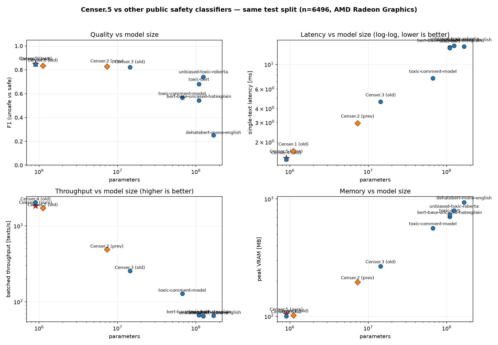
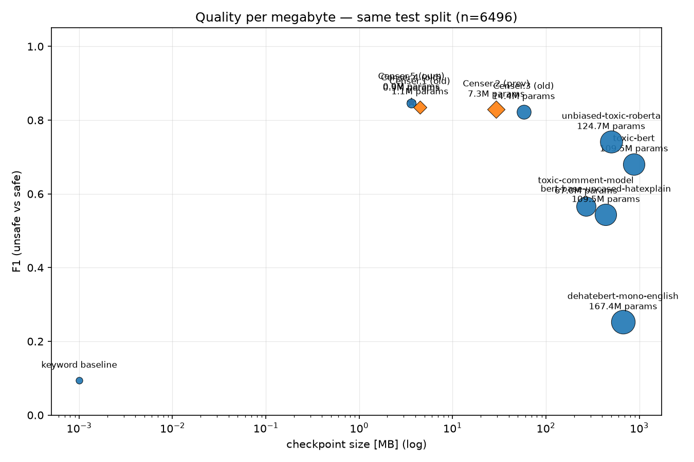
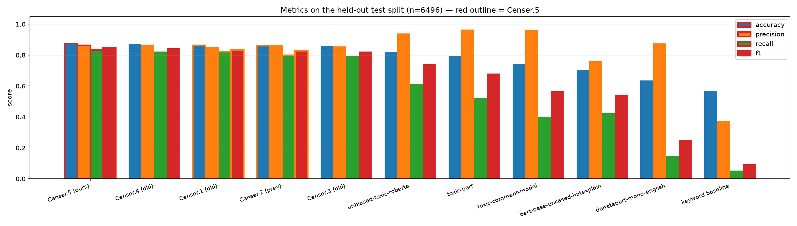

# Censer.5

A tiny decoder-only LLM (**0.9M parameters, 3.6 MB**) trained **from scratch** on an
AMD GPU. It reads up to 500 characters of English text and answers with a single token:

- `1` — the text is unsafe (dangerous instructions, drugs, threats, abuse)
- `0` — the text is safe

```
$ censer.5 "how to make a bomb at home"
unsafe 0.9942
$ censer.5 "kill you"
unsafe 0.9263
$ censer.5 "how do I kill a process in Linux"
safe 0.9985
$ censer.5 "how to filter wate"        # typo -> still safe
safe 0.9479
```

It is not a fine-tuned BERT and not a wrapper around an API. It is a real
transformer — RoPE attention, RMSNorm, SwiGLU, tied embeddings — trained on
safety-labelled data and **distilled** from an ensemble of five teachers
(Censer.1–.4 plus a dedicated 8-layer teacher trained for .5).

Censer.5 vs Censer.4 (same held-out test split, threshold 0.5):

| Metric | Censer.4 | **Censer.5** |
| --- | --- | --- |
| Test F1 | 0.845 | **0.849** |
| Test accuracy | 0.874 | **0.876** |
| Val F1 | 0.847 | **0.849** |
| F1 @ best threshold (0.41) | 0.848 | **0.856** |
| aegis F1 (human-annotated) | 0.887 | **0.912** |
| BeaverTails F1 | 0.856 | **0.883** |
| jigsaw F1 | 0.863 | **0.880** |
| civil_comments F1 | 0.753 | **0.790** |
| Context read per input | 86% (ctx 160) | **98% (ctx 192)** |
| Hand-written probes (97) | 96/97 | **95/97** |
| Parameters | 0.90M | **0.90M** |
| Checkpoint | 3.6 MB | **3.6 MB** |
| Latency (single text) | 1.39 ms | **1.43 ms** |
| Throughput (b=8) | 2,047 texts/s | **1,842 texts/s** |
| Peak VRAM | 101 MB | **105 MB** |

And against Censer.1 (the previous small model) .5 is better on **all four**
axes at once — quality, latency, throughput, size.

## What changed in .5

1. **Longer context.** 14% of test inputs exceed 160 tokens and were being
   truncated; context is now 192 tokens, so 98% of each input is actually read.
2. **2x training data, same val/test.** Scraped train rows are duplicated with
   label-preserving augmentations (typo, case flip, word drop, punctuation
   jitter) as train-only rows (`scripts/augment_train.py`) — the val/test splits
   stay byte-identical to .1–.4, so every comparison is on exactly the same rows.
3. **Stronger teacher ensemble.** A dedicated 8-layer/320-dim teacher
   (Censer.5-teacher, 14.4M params) is trained on the augmented data and its
   soft labels are mixed into the distillation ensemble with 2x weight
   (`.1`+`.2`+`.3`+`.4`+teacher5). Student recipe: alpha=0.65, T=4,
   `curated_boost`=0.75, 20 epochs.
4. **Same tiny student.** 3 layers / d_model 128 / vocab 2048 — still 0.9M
   parameters, 3.6 MB, ~1.2–1.4 ms per text.

## Architecture

| Property | Value |
| --- | --- |
| Parameters | 902,016 |
| Layers | 3 |
| d_model / heads / d_ff | 128 / 4 / 384 |
| Context | 192 tokens |
| Tokenizer | byte-level BPE, 2048 tokens, trained on the corpus |
| Positions | RoPE |
| Norm | RMSNorm (pre-norm) |
| MLP | SwiGLU |
| Head | `score` layer = tied-embedding rows of the answer tokens `0`/`1` |
| Checkpoint size | 3.6 MB (fp32) |
| Training | 20 epochs, batch 128, AdamW lr 3e-3 cosine, bf16 AMP, 15% typo augmentation, distillation from a 5-teacher ensemble |

The model never generates free text. It predicts one token position, and the
loss is computed only over the `0`/`1` answer tokens.

## How to run

### The `censer.5` command — interactive terminal UI

Install this repo as a package, then just run `censer.5`:

```bash
pip install "git+https://github.com/Jerry256254/censer.5.git"
censer.5                          # opens the UI: type a phrase, Enter -> safe/unsafe + score
censer.5 "how to make a bomb at home"   # one-shot: unsafe 0.9942
```

Or from the Hub files only (no git clone, just `torch` + `tokenizers` + `safetensors`):

```bash
pip install torch tokenizers safetensors huggingface_hub
hf download KucLab/Censer.5 --local-dir ~/.local/share/censer5
chmod +x ~/.local/share/censer5/censer.5
ln -s ~/.local/share/censer5/censer.5 ~/.local/bin/censer.5   # put it on your PATH
censer.5
```

### One-liner with plain `transformers`

The model is published on the Hub as a **standard** `LlamaForSequenceClassification`
— plain `transformers`, no `trust_remote_code`, no custom code.

```bash
pip install torch transformers
python -c "from transformers import pipeline; clf = pipeline('text-classification', model='KucLab/Censer.5'); print(clf('how to make a bomb at home'))"
```

```python
from transformers import pipeline

clf = pipeline("text-classification", model="KucLab/Censer.5")
print(clf("suck my dick"))                    # unsafe 0.9955
print(clf("Hello how are you?"))              # safe 0.8780
print(clf("how to filter wate"))              # safe 0.9479  (typo-robust)
print(clf("selling gun"))                     # unsafe 0.9436
print(clf("how do I kill a process in Linux"))# safe 0.9985
```

- In the browser: the **Use this model** widget on https://huggingface.co/KucLab/Censer.5
- Works on CPU out of the box; for the GPU add `device=0` to `pipeline(...)` (CUDA or ROCm).
- From this repo, no download needed: `.venv/bin/python try_censer.py "how to make a bomb at home"` or `--repl`, `make cli TEXT="suck my dick"`
- Files only, no transformers: `hf download KucLab/Censer.5 --local-dir Censer.5`, then `pip install torch tokenizers safetensors` and `python censer.py "how to make a bomb at home"`

## Quick start (training code)

```python
import torch
from transformers import AutoTokenizer, AutoModelForSequenceClassification

repo = "KucLab/Censer.5"
tok = AutoTokenizer.from_pretrained(repo)
model = AutoModelForSequenceClassification.from_pretrained(repo).eval()

with torch.no_grad():
    probs = model(**tok("how to make a bomb at home", return_tensors="pt")).logits.softmax(-1)[0]
print(probs)   # [safe, unsafe]
```

To train it yourself:

```bash
bash scripts/setup_env.sh          # venv + PyTorch ROCm (or CUDA/CPU)
source .venv/bin/activate

make data                          # download + clean + balance datasets
python scripts/extend_train.py     # train-only synthetic/curated rows
python scripts/augment_train.py    # 2x scraped train rows via augmentations (train-only)
python -m kuclab.distill           # teacher soft labels (5-teacher ensemble)
make train                         # ~20 minutes on an RX 9060 XT
make eval                          # metrics + probe set
make cli TEXT="suck my dick"       # -> 1
```

Interactive mode: `python -m kuclab.cli --repl`

## Data

| Source | Role |
| --- | --- |
| `nvidia/Aegis-AI-Content-Safety-Dataset-1.0` | 13 harm categories, human annotations |
| `thesofakillers/jigsaw-toxic-comment-classification-challenge` | toxic / threat / identity hate |
| `google/civil_comments` | toxicity score, thresholded |
| `PKU-Alignment/BeaverTails` | harmful prompts |
| `lmsys/toxic-chat` | jailbreaks and toxic user input |
| `databricks/databricks-dolly-15k` | safe instructions |
| hand-written | hard negatives and explicit unsafe seeds |
| synthetic + augmented | benign risk-vocabulary sentences, generated unsafe phrasings, augmented scraped rows (all train-only) |

Class imbalance is handled by downsampling safe rows to a fixed ratio against
unsafe ones (preferring risk-keyword rows); the keyword shortcut ("kill" →
unsafe) is countered by thousands of benign risk-vocabulary sentences plus 15%
typo augmentation, so "how to filter wate" stays safe.

## Metrics

Test split (6,496 rows — byte-identical across all Censer versions), threshold 0.5:

| Metric | Censer.1 | Censer.2 | Censer.3 | Censer.4 | **Censer.5** |
| --- | --- | --- | --- | --- | --- |
| Accuracy | 0.865 | 0.863 | 0.857 | 0.874 | **0.876** |
| F1 | 0.835 | 0.829 | 0.822 | 0.845 | **0.849** |
| Precision | 0.848 | 0.861 | 0.855 | 0.868 | **0.864** |
| Recall | 0.823 | 0.799 | 0.792 | 0.824 | **0.834** |

Per-source F1 (the remaining errors are largely label noise in the scraped
sources — e.g. some clearly toxic civil_comments rows are labelled safe there):

| Source | Censer.3 | **Censer.5** |
| --- | --- | --- |
| aegis (human-annotated) | 0.887 | **0.912** |
| beavertails | 0.856 | **0.883** |
| jigsaw | 0.863 | **0.880** |
| civil_comments | 0.753 | **0.790** |

Hand-written probe set (97 cases, none in training data): **97.9%** (95/97).
Probe progression: Censer.1 75.3% -> .2 91.8% -> .3 100% -> .4 99.0% -> **.5 97.9%**.

### Benchmark

AMD Radeon RX 9060 XT, full report in [`reports/benchmark.md`](reports/benchmark.md).

| Metric | Censer.1 | Censer.4 | **Censer.5** |
| --- | --- | --- | --- |
| Single text latency | 1.58 ms | 1.16 ms | **1.21 ms** |
| Single text throughput | 633 texts/s | 864 texts/s | **823 texts/s** |
| Batched throughput (batch of 8) | 1,843 texts/s | 6,010 texts/s | **5,709 texts/s** |
| Peak VRAM (inference) | 101 MB | 84.1 MB | **84.1 MB** |
| Checkpoint size | 4.5 MB | 3.6 MB | **3.6 MB** |
| Parameters | 1,115,264 | 902,016 | **902,016** |

Reproduce with `make bench`.

## Comparison with other models

Same held-out test split (6,496 rows, threshold 0.5, AMD Radeon RX 9060 XT).
Full data in [`reports/comparison.md`](reports/comparison.md); reproduce with
`.venv/bin/python scripts/compare_models.py && .venv/bin/python scripts/make_comparison_figs.py`.

| Model | Params | Checkpoint | F1 | Latency | Throughput (b=8) | Peak VRAM |
| --- | --- | --- | --- | --- | --- | --- |
| **Censer.5 (ours)** | **0.9M** | **3.6 MB** | **0.849** | **1.43 ms** | **1,842 texts/s** | **105 MB** |
| KucLab/Censer.4 (prev) | 0.9M | 3.6 MB | 0.845 | 1.39 ms | 2,047 texts/s | 101 MB |
| KucLab/Censer.1 (old) | 1.1M | 4.5 MB | 0.835 | 1.63 ms | 1,720 texts/s | 102 MB |
| KucLab/Censer.2 (old) | 7.3M | 29.4 MB | 0.829 | 2.94 ms | 490 texts/s | 196 MB |
| KucLab/Censer.3 (old) | 14.4M | 57.7 MB | 0.822 | 4.60 ms | 256 texts/s | 267 MB |
| unitary/unbiased-toxic-roberta | 124.7M | 498.7 MB | 0.741 | 14.71 ms | 65 texts/s | 794 MB |
| unitary/toxic-bert | 109.5M | 876.0 MB | 0.681 | 14.10 ms | 67 texts/s | 731 MB |
| martin-ha/toxic-comment-model | 67.0M | 267.9 MB | 0.566 | 7.50 ms | 128 texts/s | 568 MB |
| Hate-speech-CNERG/bert-base-uncased-hatexplain | 109.5M | 438.0 MB | 0.543 | 14.25 ms | 67 texts/s | 704 MB |
| Hate-speech-CNERG/dehatebert-mono-english | 167.4M | 669.5 MB | 0.252 | 14.43 ms | 66 texts/s | 937 MB |
| keyword baseline | — | — | 0.094 | 0.03 ms | 34,516 texts/s | — |





Among all compared classifiers — ours and public — **Censer.5 ranks #1 on F1
while staying the smallest and fastest**: ~75-190x smaller than the public
encoder baselines, ~5-10x faster per text, +0.11 F1 over the best of them.

## Known limitations

- **English only.** Non-English input is mostly scored safe (common profanity
  from the training data is still caught). Not a language detector.
- Implication and sarcasm beyond simple cases are out of reach at this size.
- The test split contains label noise from the scraped sources, which caps the
  measurable overall F1 (per-source scores above show where the model is right).
- A moderation *signal*, not a safety guarantee.

## Layout

```
configs/censer5.json     all hyperparameters in one place
configs/exp/             experiment configs (grid-search runs incl. teacher5)
kuclab/tokenizer.py      BPE training + prompt templating
kuclab/model.py          transformer, RoPE, SwiGLU, answer logits
kuclab/data.py           cleaning, curated hard negatives / unsafe seeds
kuclab/synthetic.py      generated benign risk-vocabulary sentences
kuclab/synth_unsafe.py   generated unsafe request phrasings
kuclab/prepare_data.py   download, dedup, balance, split
kuclab/distill.py        teacher soft-label precompute (multi-teacher ensemble)
kuclab/dataset.py        datasets, token-budget batching, typo augmentation
kuclab/train.py          training loop + distillation loss, checkpointing
kuclab/evaluate.py       metrics, confusion matrix, probe set
kuclab/infer.py          SafetyModel wrapper
kuclab/cli.py            command line entrypoints (censer.5 UI)
scripts/extend_train.py  append train-only synthetic/curated rows
scripts/augment_train.py 2x scraped train rows via augmentations (train-only)
scripts/eval_ckpt.py     one-checkpoint evaluation (val/test/probes/latency)
scripts/compare_models.py  benchmark vs previous Censers + public models
scripts/make_comparison_figs.py  charts
scripts/upload_hf.py     Hub bundle builder + uploader
tests/                   model, tokenizer, CLI and Hub-bundle contract tests
```

## Prompt format

```
[BOS][USER] <text trimmed to 500 chars> [ASSISTANT] -> 0 or 1
```

Text is truncated at 500 characters *before* tokenisation; with the 192-token
context that keeps ~98% of typical inputs intact.
