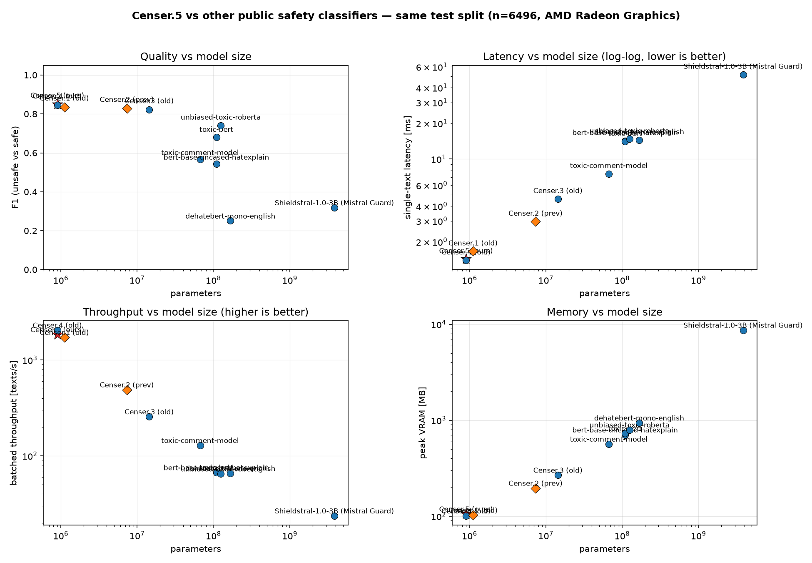
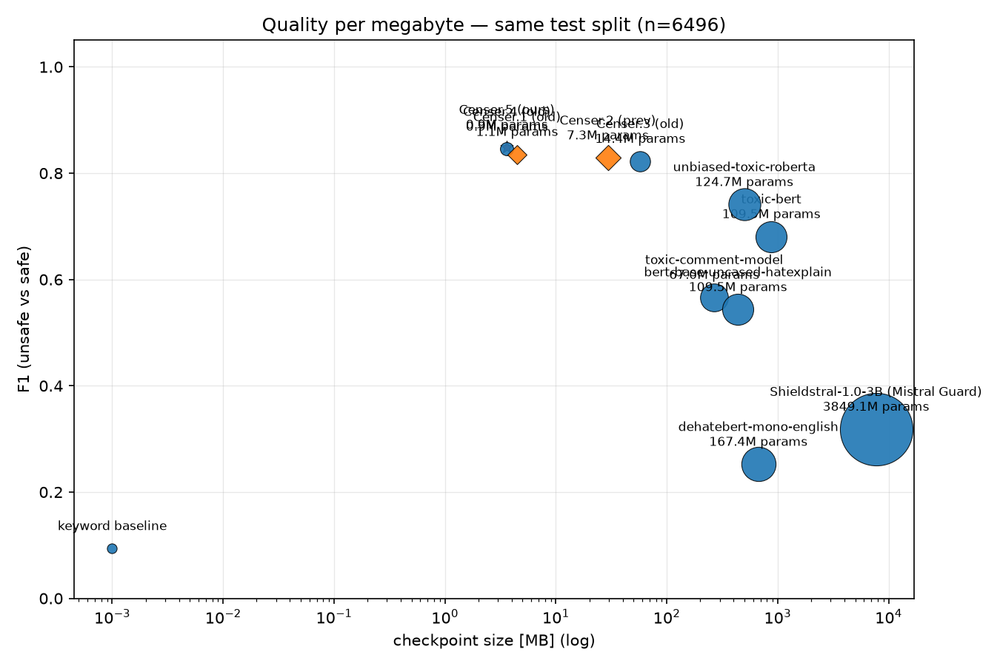
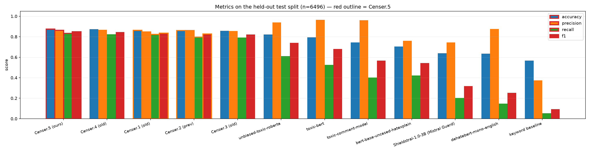

# Comparison with other public safety classifiers

Same held-out test split for every model: `data/processed/test.jsonl` (n=6496), threshold 0.5. Hardware: AMD Radeon Graphics.

| Model | Params | Checkpoint | Accuracy | Precision | Recall | F1 | Latency | Throughput (b=32) | Peak VRAM |
| --- | --- | --- | --- | --- | --- | --- | --- | --- | --- |
| Censer.5 (ours) | 0.9M | 3.6 MB | 0.876 | 0.864 | 0.834 | **0.849** | 1.43 ms | 1842 texts/s | 105 MB |
| Censer.4 (old) | 0.9M | 3.6 MB | 0.874 | 0.868 | 0.824 | **0.845** | 1.39 ms | 2047 texts/s | 101 MB |
| Censer.1 (old) | 1.1M | 4.5 MB | 0.865 | 0.848 | 0.823 | **0.835** | 1.66 ms | 1719 texts/s | 102 MB |
| Censer.2 (prev) | 7.3M | 29.4 MB | 0.863 | 0.861 | 0.799 | **0.829** | 2.96 ms | 489 texts/s | 196 MB |
| Censer.3 (old) | 14.4M | 57.7 MB | 0.857 | 0.855 | 0.792 | **0.822** | 4.60 ms | 256 texts/s | 267 MB |
| unbiased-toxic-roberta | 124.7M | 498.7 MB | 0.822 | 0.940 | 0.612 | **0.741** | 14.73 ms | 65 texts/s | 794 MB |
| toxic-bert | 109.5M | 876.0 MB | 0.794 | 0.965 | 0.526 | **0.681** | 14.04 ms | 67 texts/s | 731 MB |
| toxic-comment-model | 67.0M | 267.9 MB | 0.744 | 0.961 | 0.402 | **0.566** | 7.50 ms | 128 texts/s | 564 MB |
| bert-base-uncased-hatexplain | 109.5M | 438.0 MB | 0.704 | 0.761 | 0.423 | **0.543** | 14.23 ms | 67 texts/s | 704 MB |
| Shieldstral-1.0-3B (Mistral Guard) | 3849.1M | 7700.0 MB | 0.639 | 0.745 | 0.202 | **0.318** | 51.62 ms | 24 texts/s | 8692 MB |
| dehatebert-mono-english | 167.4M | 669.5 MB | 0.636 | 0.875 | 0.147 | **0.252** | 14.46 ms | 66 texts/s | 937 MB |
| keyword baseline | 0.0M | 0.0 MB | 0.568 | 0.374 | 0.054 | **0.094** | 0.03 ms | 34514 texts/s | 0 MB |

Shieldstral (Mistral Guard) row measured by `scripts/bench_shieldstral.py` (policy query, single yes/no token, @0.5; best-threshold F1 0.479 @0.05 shown in parentheses).

Reproduce: `.venv/bin/python scripts/compare_models.py && .venv/bin/python scripts/make_comparison_figs.py`
